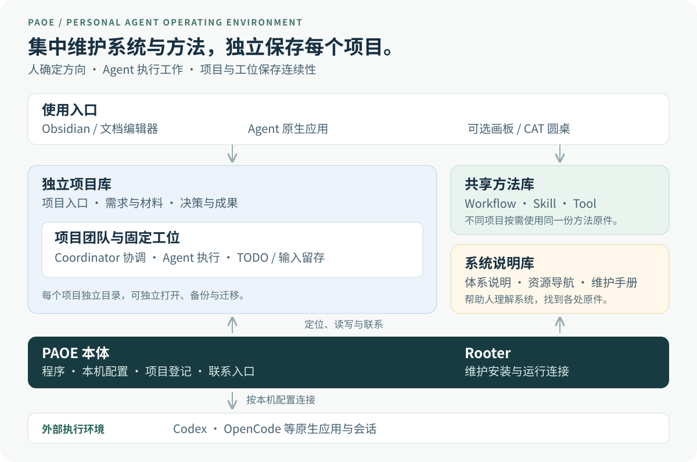

# PAOE

> **让 Agent 的工作，持续跨越对话。**

**Personal Agent Operating Environment · 个人 Agent 工作环境**

PAOE 把长期工作放在你自己的电脑上：项目有独立资料库，Agent 有固定工位，方法可以共享，成果可以积累。关闭对话、换一个模型或重开电脑后，Agent 能沿原来的入口找回责任，继续推进。

[了解整体结构](#一张图看懂-paoe) · [开始使用](docs/setup/QUICKSTART.md) · [查看架构](ARCHITECTURE.md) · [学习路线](LEARNING-BASELINE.md)

## 一张图看懂 PAOE

**系统集中维护，项目独立保存。** PAOE 本体、共享方法库、系统说明库各有自己的位置；每个项目拥有自己的目录和资料边界，通过登记连接起来，可以放在不同磁盘。

## 各部分分别放什么

| 部分 | 你会在这里找到 | 它负责什么 |
| --- | --- | --- |
| **项目库 · Project Vault** | 项目入口、需求与材料、决策与成果、团队和 Agent 工位 | 保存“这件事在做什么、做到哪里、产出了什么”。一个项目可以作为独立 Obsidian 库打开；需要版本管理时使用自己的 Git 仓库。 |
| **共享方法库 · Library** | Workflow 流程与指南、Skill 专业方法、Tool 工具目录 | 保存“事情可以怎么做”，供不同项目按需复用。 |
| **系统说明库 · System Vault** | 人类可读的首页、体系说明、资源导航、维护手册 | 帮你理解整套环境，并打开实际的项目、方法和维护入口。 |
| **PAOE 本体 · Core & Installation** | 程序、本机配置、项目位置登记、联系入口、Rooter 工位 | 连接各个独立部分，提供稳定的读写与接续能力。 |
| **执行环境 · Runtime** | Codex、OpenCode 等原生 Agent 应用与会话 | 让 Agent 实际思考、使用工具和执行工作；具体登录与唤醒能力按本机配置。 |

项目正文留在项目库，方法正文留在共享库，系统说明库提供解释与导航。**每份内容有明确的原件，入口指向它。**

## 谁负责什么

| 角色 | 责任范围 |
| --- | --- |
| **你 · Human** | 确定目标、优先级与授权，判断成果是否满足需要。 |
| **Coordinator · 项目协调者** | 对齐本项目的目标、分工与交付，协调项目成员。 |
| **Agent · 项目成员** | 在自己的固定工位接收输入、维护当前行动、完成工作，把成果写回项目。 |
| **Rooter · 环境维护者** | 维护本机安装、共享入口与运行连接；它拥有独立的安装级工位。 |

工位是 Agent 长期工作的落脚点：入口说明身份与资源位置，TODO 保存当前行动，邮件与通知保存输入和处理记录。**会话是一次运行，工位让工作延续。**

## 一件工作怎样持续推进

**提出目标 → 回到工位 → 查方法或找同事 → 执行并保存成果 → 交付 → 继续主线**

例如，让 Agent 整理一份长期研究：研究材料和结论保存在项目库；Agent 从共享库寻找合适的方法，在自己的工位记录下一步。下次打开原生应用时，它沿入口读回当前行动，继续处理同一份研究。

成员之间可以留信；配置好运行入口后，还可以请求原生提醒。**消息已保存、提醒已受理、Agent 已读取、任务已完成，是分别需要确认的事实。**

## 你可以怎样使用它

- **Obsidian / Markdown 编辑器**：阅读和维护项目资料、成果与共享方法，从系统说明库进入各部分。
- **Agent 原生应用**：直接与 Codex、OpenCode 等应用里的成员一起工作，让它从自己的工位接续。
- **可选画板**：浏览项目与成员，查看工位和项目入口；连接独立 CAT 后，可围绕主题开展圆桌讨论。

这些入口围绕同一批原件工作。画板关闭后，项目资料与工位仍然保留；讨论形成的结论应写回项目正文。

看看画板原型

图片来自 WorkBuddy 原型，用于说明交互形态。当前接入版读取 Portable 的真实登记和工位，具体界面与 CAT 操作以目标电脑验证为准。见[画板说明](front/README.md)。

## 从哪里开始

先在本机准备安装，再选择一个真实项目和它的成员。**取得代码包与方法资产后，还需要配置本机项目、工位和运行入口。**

| 你现在想做什么 | 从这里进入 |
| --- | --- |
| 第一次安装、检查环境 | [快速开始](docs/setup/QUICKSTART.md) |
| 理解各层关系和事实归属 | [系统架构](ARCHITECTURE.md) |
| 配置独立系统说明库、连接分散项目 | [本机配置指导](docs/setup/PAOE-CENTRAL-CORE-DISTRIBUTED-PROJECTS.md) · [System Vault 工具](docs/setup/SYSTEM-VAULT-TOOL.md) |
| 阅读共享流程与专业方法 | [Workflow](libraries/workflow/README.md) · [Skill](libraries/skill/README.md) |
| 打开可选画板 | [画板使用说明](front/README.md) |
| 学习或参与开发 | [学习路线](LEARNING-BASELINE.md) · [代码地图](code/personal-agent-os/docs/CODE-MAP.md) |
| 换电脑或选择迁入资料 | [迁移说明](MIGRATION-NOTES.md) |

PAOE 当前面向个人电脑上的长期 Agent 工作。基础文件操作可独立使用；原生提醒、画板和 CAT 按需要配置。现有 CLI 与配置中保留的 `paos` / `PAOS_*` 是兼容性标识，使用方法见[快速开始](docs/setup/QUICKSTART.md#名称与开发入口)。
