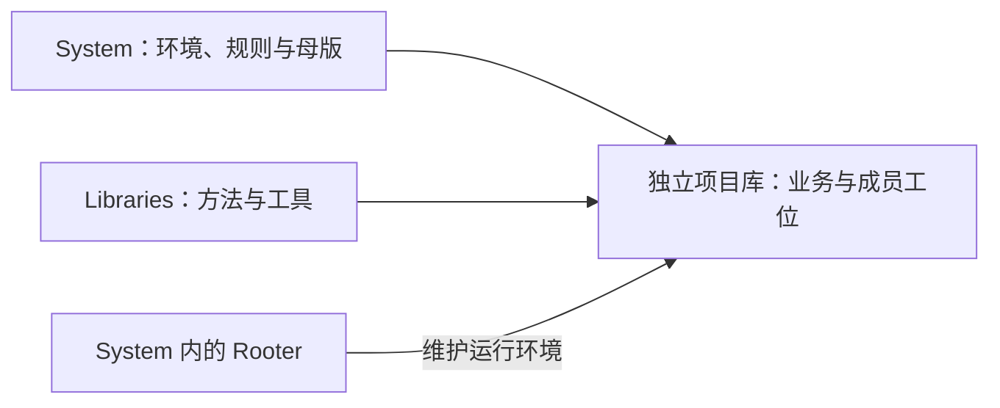

# PAOE 体系

<!-- paoe:human-intro:start -->
> 三类库各管一类事情：System 管运行环境，Libraries 管方法，项目库管具体工作。
<!-- paoe:human-intro:end -->

<!-- paoe:agent-reference -->
## 操作与参考

## 三类库的边界

| 库 | 保存什么 |
| --- | --- |
| **System** | 硬基座、Rooter 工位、CAT、通用运行规则 SSOT、项目库母版及系统入口。 |
| **Libraries** | 可复用的任务 Workflow、专业 Skill、Tool。 |
| **独立项目库** | 各项目的最新业务口径、材料、成果及项目成员工位。 |

System 的规则说明 Agent 怎样在 PAOE 中工作；Libraries 的方法说明某类任务怎样完成。项目使用各自的独立目录、Obsidian 库和 Git 历史。新建或登记 Project 由 Human 明确决定。

## System 里实际有什么

| 目录 | 内容 |
| --- | --- |
| `Core/` | 程序、机器配置、Project Registry。实现文件在维护或开发时查阅。 |
| `rooter/` | README 是公共入口；ENTRY、TODO、Mail、Notice、Contact 与 Records 属于每机实例。 |
| `Guide/` | 按需专题操作说明；公共运行正文唯一编辑母本是 `Project-Template/AGENTS.md`。 |
| `Project-Template/` | 新项目库母版；实际项目在各自目录登记。 |
| `CAT/` | 聊天室入口；服务与房间按本机实际配置。 |
| `Learning/` | 学习路线与个人笔记。 |

根目录五页负责日常阅读；实体目录各自保存原件。历史备份集中在 `.backups/`。

## 一份事实放在哪里

| 内容 | 维护原件 |
| --- | --- |
| 项目与成员的位置 | Core 的 Project Registry；[项目与 Agent](PROJECTS.md)由登记与 TEAM 聚合生成。 |
| 成员职责与专长 | 对应项目 TEAM；工位 ENTRY 直链本人条目。 |
| Harness 与唤醒配置 | Harness 读本人 ENTRY，绑定与 STOP 读 Contact；聚合页只提供入口，不探测在线。 |
| 项目共识、重要文档和成果 | 对应项目的 INDEX 与业务正文。 |
| 本人目标、下一步和任务状态 | 本人工位 TODO v4，沿现有写者及指纹操作。 |
| 通用运行行为 | 项目生效 `AGENTS.md`（派生自 [母本](Project-Template/AGENTS.md)）；专题在 [Guide](Guide/README.md)。 |
| 任务方法与专业操作 | [Libraries 原件](RESOURCES.md)。 |
| 安装位置与原生连接 | Installation / Contact；准确入口见[维护](MAINTENANCE.md)。 |
| 输入与处理事实 | 所属 Home 的 Mail / Notice。 |

页面引用原件，事实变化时改对应原件。普通正文、说明和个人笔记可以直接编辑，机器配置与 TODO 按现有合同维护。

## 本机定位

System 是当前安装的公共系统目录。准确代码、数据、Rooter 与 Libraries 位置读本机安装描述及 `install show`；项目位置读本机 Registry 与[项目聚合页](PROJECTS.md)，不从发布包继承另一台电脑的路径或成员。

旧安装、交换资料和回退目录由本机维护者记录在 Rooter 的维护记录中，不作为公共发布的固定目录。

本机通用运行原件使用 Project-Template/AGENTS 公共区；生效项目 AGENTS 保留派生公共区和人工项目约定。Guide 是专项操作说明，专业方法使用登记的独立 Libraries。
